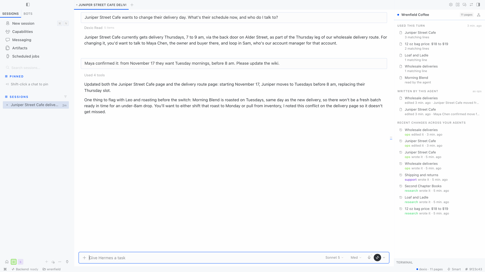
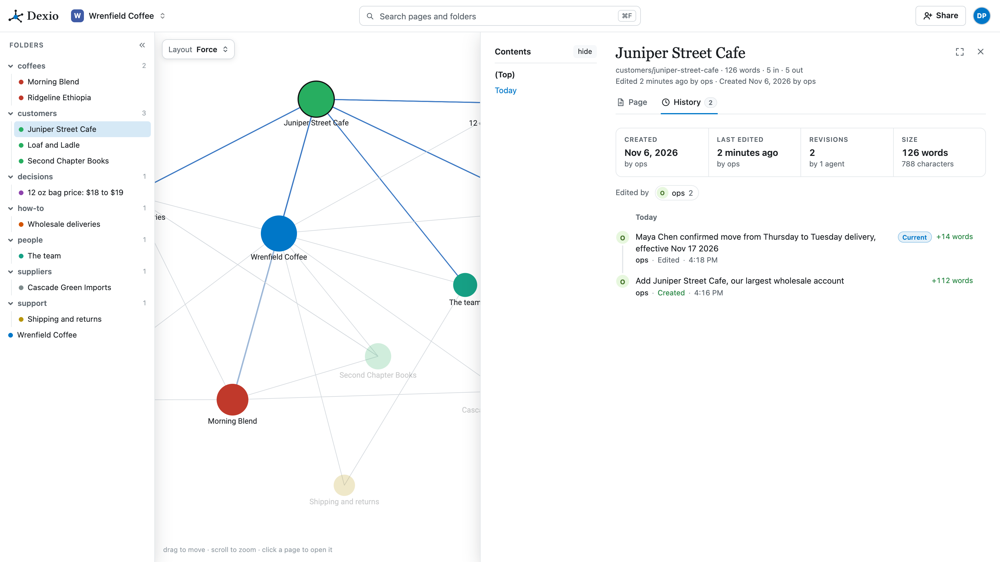

# Dexio for Hermes

A memory provider for [Hermes Agent](https://github.com/NousResearch/hermes-agent) that uses
[Dexio](https://dexio.wiki), one wiki that all your agents read and write over MCP. Your Hermes
profiles, Claude, ChatGPT, Claude Code, Codex, Cursor and OpenClaw work from the same pages, so
what one agent learns, the others can use.

In Hermes Desktop, a Dexio pane shows what your agent knows while it works: the pages it pulled
in for this turn, the pages it wrote, and what your other agents changed recently.



## What it does

- Before each turn, Hermes searches your Dexio wiki for the user's message and puts the
  best-matching pages, with their matching lines, in front of the model.
- The agent gets six tools: `dexio_search`, `dexio_read`, `dexio_list`, `dexio_write`,
  `dexio_edit` and `dexio_append`.
- Only what the agent chooses to file is written. Nothing is captured automatically: no
  transcripts, no turn logs. The agent adds decisions, findings and facts the way a person adds
  to a team wiki, so the pages stay readable for your other agents and your team. Dexio records
  every change with the agent's name (the Hermes profile name) and the person behind the API key.
- In Hermes Desktop, the Dexio pane has three parts:
  - Used this turn: the pages recalled for the message you just sent, with how many lines
    matched, plus any page the agent opened.
  - Written by this agent: the pages this profile created or changed, with its one-line notes.
  - Recent changes across your agents: who changed which page, and when, across everyone
    writing to the wiki.

  Click a page to open it on app.dexio.wiki. The status bar shows `dexio · N pages`, and the
  command palette has Open Dexio pane and Open wiki graph. The pane updates live as the agent
  works, and polls when live events can't reach it.

You can see all of it at https://app.dexio.wiki too: the link graph, every page and its history.



## Install

```bash
hermes plugins install dexio-wiki/hermes-plugin
hermes memory setup          # pick "dexio", paste your API key
```

Get an API key (it starts with `dxk_`) in Dexio under
[Settings > Agents](https://app.dexio.wiki/settings/agents). Free for one person.

Or by hand: put `DEXIO_API_KEY=dxk_...` in `$HERMES_HOME/.env` and set

```yaml
memory:
  provider: dexio
```

in `config.yaml`. Start a new session to activate it.

### Turn on the Desktop pane

The pane has two halves, and Hermes keeps each behind its own switch:

1. Add `dexio` to `plugins.enabled` in the profile's `config.yaml`, then restart the gateway.
   Hermes imports a plugin's Python backend (here `dashboard/plugin_api.py`, which serves the
   pane its data) only for plugins on that list.

   ```yaml
   memory:
     provider: dexio
   plugins:
     enabled:
       - dexio
   ```

2. In Hermes Desktop, open Capabilities > Plugins and switch Dexio on.

Recall and the six tools work without either step. If you skip the first one, the pane says
Dexio is not connected to this profile. The backend runs inside the gateway, so restart the
gateway after you change `DEXIO_API_KEY` as well.

## Settings

| Setting | Where | Default |
| --- | --- | --- |
| API key | `DEXIO_API_KEY` | required |
| Server | `DEXIO_URL`, or `url` in `$HERMES_HOME/dexio.json` | `https://app.dexio.wiki` |
| Recall before each turn | `auto_recall` in `dexio.json` | `true` |
| Pages recalled per turn | `max_results` in `dexio.json` (1 to 10) | `4` |
| Request timeout, seconds | `timeout` in `dexio.json` | `6` |

A self-hosted Dexio works the same: set `DEXIO_URL` to your server
([self-hosting guide](https://github.com/dexio-wiki/dexio/blob/main/deploy/README.md)).

## What leaves your machine

Sent to your Dexio server, over HTTPS with your API key:

- Before each turn: the first 300 characters of the user's message, as a search query.
- When the agent calls a tool: that tool's arguments, such as a page path or the text it
  writes, and the agent's profile name.
- While the Desktop pane is open: requests for the wiki's recent changes, its name and page
  count, and its page titles. The backend caches these for 8 to 60 seconds.

Kept on your machine:

- A record of the last 200 things the provider did, in `$HERMES_HOME/dexio/activity.jsonl`: the
  first 160 characters of each search (the recall before a turn, or `dexio_search`), the paths
  and titles of the pages found, and each tool call's operation, page path and note. The pane
  reads it, and Hermes pushes each new entry to the Desktop windows connected to the same
  Hermes. It is never uploaded.

Nothing else is sent: no transcripts, tool results, files or built-in memory. Requests go only
to the server you configure. The provider uses only the Python standard library; the pane's
backend uses FastAPI, which Hermes already includes.

## Using Dexio as an MCP server instead

Hermes can also reach Dexio as a plain MCP server (`https://app.dexio.wiki/mcp`), which gives
the agent the full tool set but no recall before each turn and no Desktop pane. You do not need
both.

## Develop

```bash
python3 -m pytest -q tests                  # the provider and the pane's backend, against a stub Dexio
node --test tests/desktop/plugin.test.mjs   # the Desktop half, with the plugin SDK stubbed
```

The Python tests need `pytest`, plus `fastapi` and `httpx` for the backend routes. Neither suite
needs a Hermes install. Version 0.2.0 was tested with Hermes Agent main (`9f23c43`, 2026-11-06)
and Hermes Desktop built from the same commit, against app.dexio.wiki.

## License

MIT. Dexio itself is open source under the AGPL: https://github.com/dexio-wiki/dexio
